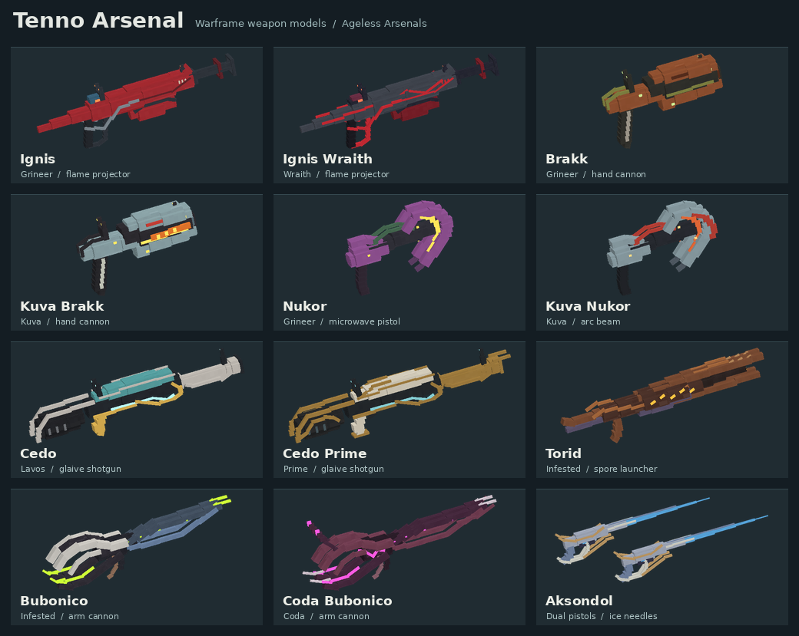

# Grineer, Infested and signature Warframe models

These twelve Minecraft models use hand-authored geometry and original pixel surfaces. The Warframe Wiki and the matching Digital Extremes inventory renders informed the silhouettes, colors and moving parts. The renders are accessible through the WFCD public-export mirror. All baked geometry, texture atlases and the preview below are Ageless Arsenals art.

| Weapon | Details retained in the model | Reference |
|---|---|---|
| Ignis | Red elongated flame shroud, lower reservoir, separate return line, hollow pilot cage. | [Wiki](https://wiki.warframe.com/w/Ignis) · [Inventory render](https://raw.githubusercontent.com/WFCD/warframe-items/master/data/img/Ignis.png) |
| Ignis Wraith | Dark shell, scarlet forked casing pattern, and red reinforced guard. | [Wiki](https://wiki.warframe.com/w/Ignis_Wraith) · [Inventory render](https://raw.githubusercontent.com/WFCD/warframe-items/master/data/img/IgnisWraith.png) |
| Brakk | Bulbous brown upper and lower jaws, exposed central feed, short wide muzzle, curved heel. | [Wiki](https://wiki.warframe.com/w/Brakk) · [Inventory render](https://raw.githubusercontent.com/WFCD/warframe-items/master/data/img/Brakk.png) |
| Kuva Brakk | Pale gunmetal outer jaws, branching crimson markings and a hot orange-yellow channel. | [Wiki](https://wiki.warframe.com/w/Kuva_Brakk) · [Inventory render](https://raw.githubusercontent.com/WFCD/warframe-items/master/data/img/KuvaLichBrakkSkin.png) |
| Nukor | Purple swept emitter shells, rear twin pods, looping conductor and yellow split seam. | [Wiki](https://wiki.warframe.com/w/Nukor) · [Inventory render](https://raw.githubusercontent.com/WFCD/warframe-items/master/data/img/Nukor.png) |
| Kuva Nukor | Silver overlapping blades, red conductors and orange vanes surrounding the emitter lens. | [Wiki](https://wiki.warframe.com/w/Kuva_Nukor) · [Inventory render](https://raw.githubusercontent.com/WFCD/warframe-items/master/data/img/KuvaNukor.png) |
| Cedo | Turquoise upper cowl, rear glaive carrier, looping gold return line, long silver runner. | [Wiki](https://wiki.warframe.com/w/Cedo) · [Inventory render](https://raw.githubusercontent.com/WFCD/warframe-items/master/data/img/Cedo.png) |
| Cedo Prime | Pale cowl, gold receiver frame, individual rear filigree arcs and two muzzle tines. | [Wiki](https://wiki.warframe.com/w/Cedo_Prime) · [Inventory render](https://raw.githubusercontent.com/WFCD/warframe-items/master/data/img/CedoPrime.png) |
| Torid | Bifurcated brown chitin muzzle, twisted rear spur, dark tissue and amber spore nodes. | [Wiki](https://wiki.warframe.com/w/Torid) · [Inventory render](https://raw.githubusercontent.com/WFCD/warframe-items/master/data/img/Torid.png) |
| Bubonico | Separate shoulder cuff and claws, ivory plates, long paired blue-black horns and chartreuse tips. | [Wiki](https://wiki.warframe.com/w/Bubonico) · [Inventory render](https://raw.githubusercontent.com/WFCD/warframe-items/master/data/img/InfArmCannon.png) |
| Coda Bubonico | Dark wine shell, magenta ruptures, raised rear rhythm horns and pale elongated quills. | [Wiki](https://wiki.warframe.com/w/Coda_Bubonico) · [Inventory render](https://raw.githubusercontent.com/WFCD/warframe-items/master/data/img/CodaBubonico.png) |
| Aksondol | Open swept guard, silver outer ferrule, gold trailing points and a long blue ice needle. One pistol is baked and rendered independently in each hand. | [Wiki](https://wiki.warframe.com/w/Aksondol) · [Inventory render](https://raw.githubusercontent.com/WFCD/warframe-items/master/data/img/DuelistPistols.png) |

## Baking and movement

From the project root, run the following commands with Python 3, Pillow and NumPy. If the checkout keeps these two tools in a subdirectory, use that directory as the script prefix.

```sh
python tools/warframe_bio_models.py src/main/resources/assets/destiny2mc
python tools/check_warframe_bio_models.py src/main/resources/assets/destiny2mc --sheet docs/Tenno-Field-Arsenal.png
```

The item entry lives in `models/item/<id>.json`. The Aksondol entry uses NeoForge display transforms to show both pistols in the inventory, on the ground and in item frames. Its single-hand and pair meshes are in `models/item/tenno_pairs/`. `models/armory/<id>/body.json`, `action.json`, and `load.json` partition the same cuboids. For example, the Cedo loads the rear carrier, the Nukor pulses its lens, and the Brakk moves its upper jaw. Units follow the established item space with the muzzle pointing along negative Z. Each included weapon has an open sight channel centered on X 8 and Y 12.8. The geometry check verifies a half-unit-wide lane through the full length of each item and exact agreement between the complete model and the three animated groups.


